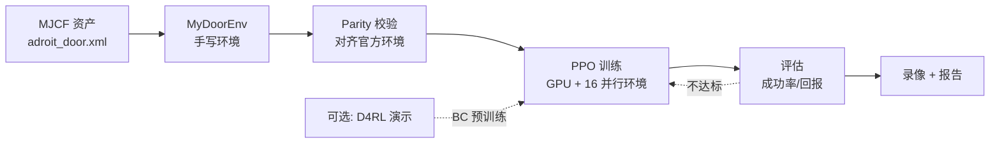

# AdroitHandDoor 复刻 + 训练全流程 · 实施规划

> **先澄清一件事**：`gymnasium_robotics` 仓库里**没有任何训练算法**——既没有 RL，也没有模仿学习。
> 它只提供环境；`learn/` 里的内容也只是"教你怎么用环境 + 自己接算法训练"。
> 所以「项目里用的是什么」的准确答案是：**训练部分项目里没有**。
> 原始 Adroit 论文（DAPG, 2017）用的是「示范增强的策略梯度」= RL + 专家演示；
> 本规划按你的要求落地为 **PPO 主线（GPU 训练 + 多进程并行采样）**；`learn/01-adroit-door.md` 推荐的是 SAC，两者在 M10 做对照实验。

> **这份文档的定位**：施工图，不是教材，更不是成品代码。
> 你负责**逐行手敲**；我负责讲清「为什么这样做、接口长什么样、怎么验收、哪里会踩坑」。
> 规则：每个里程碑你敲完 → 跑验收命令 → 把输出/报错发我 → 通过了再进下一个。

### 为什么不直接照抄 DAPG 官方实现

| 项 | DAPG 官方（2019） | 你这台机器 | 结论 |
|---|---|---|---|
| 深度学习框架 | TensorFlow 1.14 | PyTorch 2.12 (ROCm) | TF1 不支持 Python 3.13 |
| 物理接口 | `mujoco_py` + MuJoCo 2.0 | `mujoco` 3.16 | `mujoco_py` 不支持 Windows |
| 算法 | NPG（on-policy） | SB3 无此实现 | 自写成本高、样本效率低 |
| 平台 | Linux | Windows | 直接装不上 |

**硬件实测（2026-10）**：Ryzen 7 9700X（8C/16T）、31 GB 内存、RX 7900 XT；
`torch.cuda.is_available() == True`（ROCm 正常）；官方环境随机动作吞吐 **≈ 6,165 SPS**。
=> GPU 不是瓶颈，MuJoCo 仿真是瓶颈；PPO/SAC 的规模（小型 MLP）完全跑得动。

**结论**：**保留官方的任务定义**（MJCF、观测、动作、奖励——这些正是你要手敲的部分），
**只替换训练器**为 PyTorch/SB3 的 PPO（GPU 更新 + 多进程采样）。这是在你这台机器上唯一能跑通的"官方等价形式"。

---

## 0. 目标与非目标

### 最终交付（四个东西）

1. **一个自己写的环境** `MyDoorEnv`：功能与官方 `AdroitHandDoorEnv` 等价，且能与官方环境**数值对齐**。
2. **一个训练闭环**：PPO（SB3 + 16 并行环境 + ROCm GPU）在自写环境上跑起来，能存 checkpoint、能定期评估。
3. **一个可评估的策略**：成功率明显高于随机基线。
4. **一份评估报告 + 一段视频**：成功率、回报、门角度曲线、录像。

> 演示数据（D4RL `door-expert`）**不是必需品**：它属于 M10 的可选加分项（DAPG 式预训练）。

### 明确不做

- ❌ 不重写 MuJoCo、不重写 MJCF 资产（44 MB 的网格手写不出来，直接用官方资产）。
- ❌ 不修改 `gymnasium_robotics/` 里的任何官方文件。
- ❌ 不追求 SOTA 成功率。目标是**把管线跑通 + 理解每一处为什么**。

### 端到端管线



---

## 1. 先定契约（动手前必须能背出来）

写环境本质上是和算法签三份合同。**先把表填对，再写代码**。

### 1.1 动作契约：28 维，范围 [-1, 1]

| 索引 | 执行器 | 控制对象 | 索引 | 执行器 | 控制对象 |
|---:|---|---|---:|---|---|
| 0 | `A_ARTz` | 手臂前后平移 (slide) | 14–17 | `A_RFJ3..0` | 无名指 |
| 1–3 | `A_ARRx/y/z` | 手臂三轴旋转 | 18–22 | `A_LFJ4..0` | 小指（5 关节） |
| 4–5 | `A_WRJ1/0` | 腕部两关节 | 23–27 | `A_THJ4..0` | 拇指 |
| 6–9 | `A_FFJ3..0` | 食指 | | | |
| 10–13 | `A_MFJ3..0` | 中指 | | | |

关键点（必须自己验证，不能背）：

- 动作是**归一化值**，不是弧度。写进 `data.ctrl` 前要换算：
  $$a_{\text{ctrl}} = \text{act\_mean} + a \cdot \text{act\_rng}$$
  其中 `act_mean/act_rng` 由 `model.actuator_ctrlrange` 算出。
- 原始 XML 里 24 个手部执行器 + 4 个手臂执行器，**顺序就是动作下标顺序**。
- `A_THJ4` 在 XML 里没写 `ctrlrange`，MuJoCo 会给出默认 `[-1, 1]`（不是 `[0,0]`）。这点实测确认过。

### 1.2 观测契约：39 维扁平向量

| 切片 | 维度 | 内容 | 数据来源 |
|---|---:|---|---|
| `[0:27]` | 27 | 手臂 3 + 手 24 个关节角 | `qpos[1:-2]` |
| `[27]` | 1 | 门闩角 `latch` | `qpos[-1]` |
| `[28]` | 1 | 门铰链角 `door_hinge` | `qpos[door_hinge_addr]` |
| `[29:32]` | 3 | 掌心世界坐标 | `site_xpos["S_grasp"]` |
| `[32:35]` | 3 | 把手世界坐标 | `site_xpos["S_handle"]` |
| `[35:38]` | 3 | 掌心 − 把手（相对向量） | 上面两者相减 |
| `[38]` | 1 | 门是否打开：`>1.0 → +1`，否则 `-1` | `door_hinge` |

**为什么要丢掉 `qpos[0]`（`ARTz`）？**
Adroit 的观测量是历史遗留的 D4RL 约定。丢不丢对训练有影响，但**对齐目标优先于合理性**——你要的是和专家数据同分布。

**一个必须自己确认的事实**：`qpos` 的真实顺序是

```
[0:4]   ARTz, ARRx, ARRy, ARRz      ← 手臂
[4:28]  WRJ1 ... THJ0               ← 24 个手关节
[28]    door_hinge                  ← 注意！门铰链在倒数第二
[29]    latch                       ← 门闩在最后
```

所以 `qpos[1:-2]` 恰好砍掉 `ARTz`、`door_hinge`、`latch`，留下 27 维。
**别想当然把门铰链当成 `qpos[-1]`，那是门闩。**

### 1.3 奖励 / 终止契约

**稠密奖励**（默认）：

$$
r = \underbrace{-0.1\,\lVert p_{\text{palm}}-p_{\text{handle}}\rVert}_{\text{靠近把手}}
  \underbrace{-0.1\,(\theta_{\text{door}}-1.57)^2}_{\text{把门推到 90°}}
  \underbrace{-10^{-5}\sum \dot q^2}_{\text{速度惩罚}}
  + \underbrace{2\,\mathbb{1}[\theta>0.2] + 8\,\mathbb{1}[\theta>1.0] + 10\,\mathbb{1}[\theta>1.35]}_{\text{分档奖励}}
$$

**稀疏奖励**：成功 `+10`，否则 `-0.1`。

**终止条件**：`terminated=False` 永远不终止；`truncated` 由 `TimeLimit(max_episode_steps=200)` 负责。
（官方 docstring 里写「默认 50」是文档陈旧，注册表里实际是 **200**。）

**成功判定**：`door_hinge >= 1.35` rad，写进 `info["success"]`。
上限是 1.57 rad（90°），留 0.22 rad 余量的原因：贴着限位很难"精确到"。

---

## 2. 目录结构（你要建成的样子）

```
imitate/
├── 00-plan-adroit-door-full-pipeline.md   ← 本文件
├── envs/
│   ├── __init__.py
│   ├── door_env.py                    ← MyDoorEnv（核心，约 150 行）
│   └── register.py                    ← gym.register
├── rl/
│   ├── __init__.py
│   ├── train_ppo.py                   ← PPO 训练（主线）
│   ├── callbacks.py                   ← 定期评估成功率 + 保存最佳模型
│   └── evaluate.py                    ← 成功率评估
├── data/                              ← 可选，M10 才用
│   ├── __init__.py
│   ├── schema.py                      ← 数据格式 + 读写（npz）
│   ├── collect_random.py              ← 随机策略采样（对照基线）
│   └── prepare_expert.py              ← D4RL/Minari 转换
├── scripts/
│   ├── smoke_test.py                  ← 形状/API 自检
│   ├── parity_check.py                ← 与官方环境逐值对齐
│   └── record_video.py                ← 录像
├── runs/                              ← checkpoint / 日志
└── reports/                           ← 评估报告
```

**资产不复制**（44 MB，且 XML 内部 `include` 依赖相对路径），统一用常量指向官方目录：

```
ASSETS_XML = <repo_root>/gymnasium_robotics/envs/assets/adroit_hand/adroit_door.xml
```

---

## 3. 里程碑总表

| # | 里程碑 | 产出 | 验收标准 | 预计 |
|---|---|---|---|---|
| M0 | 读码 + 建骨架 | 目录、`smoke_test.py` 雏形 | 能 import、能打印版本 | 0.5h |
| M1 | 场景加载 | `door_env.py` 骨架 | `nq=nv=30, nu=28` | 1h |
| M2 | 动作映射 | `step()` 的缩放部分 | 手工算的 ctrl 与打印一致 | 0.5h |
| M3 | 观测 | `_get_obs()` | 形状 39，且与官方逐值相等 | 1h |
| M4 | 奖励 / 成功 | `step()` 奖励部分 | 同状态同动作奖励相等 | 1h |
| M5 | reset / 随机化 / 状态存取 | `reset_model`、`get/set_env_state` | 状态存取可复现 | 1h |
| M6 | 注册 + 全量 parity | `register.py`、`parity_check.py` | 6 项检查全绿 | 1.5h |
| M7 | PPO 训练闭环（GPU） | `rl/train_ppo.py` | 能训练、能存盘、日志在动 | 1.5h |
| M8 | 训练诊断与调参 | 评估 callback + 日志 | 成功率稳定 > 随机基线 | 2–4h |
| M9 | 评估 + 录像 + 报告 | `evaluate.py`、`record_video.py` | 有数字、有视频、有结论 | 1h |
| M10 | 可选进阶 | DAPG 预训练 / SAC 对照 | 由你决定 | — |

> 合计约 12–15 小时（训练机时另计）。**M3、M4、M6 是重点**，前两个决定"像不像"，第三个决定"对不对"。

---

## 4. 里程碑详解

### M0 · 读码与骨架

**要读的三处**（只读，不抄）：

| 文件 | 行号 | 看什么 |
|---|---|---|
| `gymnasium_robotics/envs/adroit_hand/adroit_door.py` | 23–24 | 相机配置 |
| 同上 | 181–188 | `metadata` |
| 同上 | 190–279 | 构造：路径、space、`frame_skip=5`、执行器增益、常用 id |
| 同上 | 281–345 | `step` / `_get_obs` |
| 同上 | 346–392 | `reset` / 状态存取 |
| `gymnasium_robotics/__init__.py` | 1088–1095 | 注册怎么写 |

**你要能回答**：

1. 为什么继承 `MujocoEnv` 而不是仓库里的 `RobotEnv`？（提示：观测格式 + D4RL 数据）
2. `frame_skip=5` 和 `metadata["render_fps"]=100` 是什么关系？
3. `self._model_names` 是干什么的？（把字符串名字缓存成 id，避免每帧查表）

**手敲**：`envs/__init__.py`、`scripts/smoke_test.py`（先只打印版本和 XML 路径是否存在）。

**验收**：

```powershell
.\.venv\Scripts\python.exe -m imitate.scripts.smoke_test
# 期望打印：python/mujoco/gymnasium 版本 + assets exist: True
```

---

### M1 · 把场景加载起来

**手敲** `envs/door_env.py` 的构造函数骨架：

```python
class MyDoorEnv(MujocoEnv, EzPickle):
    metadata = {...}                     # 先抄语义，不抄格式
    def __init__(self, reward_type: str = "dense", **kwargs): ...
```

**要做的事**（顺序很重要）：

1. 拼出 XML 绝对路径，`MujocoEnv.__init__(model_path=..., frame_skip=5, observation_space=..., default_camera_config=...)`。
2. `self._model_names = MujocoModelNames(self.model)`。
3. 解析 `reward_type`，非法值抛 `ValueError`。
4. 覆盖 `action_space` 为 `Box(-1, 1, (28,), float32)`。
5. 缓存常用 id：`S_grasp`、`S_handle`、`frame`、`door_hinge`。

**验证型问题**（跑一下打印，别猜）：

- `model.nq`、`model.nv`、`model.nu` 分别是多少？
- `model.jnt_qposadr["door_hinge"]` 和 `model.jnt_dofadr["door_hinge"]` 相等吗？为什么这个例子里相等？（提示：全是单自由度关节）
- `model.opt.timestep` 是多少？（XML 没写 → 默认 `0.002`；于是 `render_fps = 1/(0.002×5) = 100`）

**验收**：`smoke_test.py` 打印 `nq=30 nv=30 nu=28`，且能 `env.reset()` 不报错。

---

### M2 · 动作映射（28 维归一化 → 28 路 ctrl）

**手敲**：

```python
self.act_mean = ...   # 每条 ctrlrange 的中点
self.act_rng  = ...   # 每条 ctrlrange 的半宽
```

`step()` 的前三行：

```python
a = np.clip(a, -1.0, 1.0)
a = self.act_mean + a * self.act_rng
self.do_simulation(a, self.frame_skip)
```

**为什么先 clip 再缩放？**
策略输出（尤其高斯策略）会越界；先 clip 保证 ctrl 永远在合法范围，避免 MuJoCo 静默截断导致"训练信号和实际动作不一致"。

**额外要做的一步**：修改腕部和手指执行器的 PD 增益。

- `A_WRJ1..A_WRJ0`：`gainprm[:3] = [10, 0, 0]`，`biasprm[:3] = [0, -10, 0]`
- `A_FFJ3..A_THJ0`：`gainprm[:3] = [1, 0, 0]`，`biasprm[:3] = [0, -1, 0]`

**为什么要改？** 这套 `general` 执行器是位置伺服：`force = gain·ctrl + bias[1]·qpos`。
XML 里手指的 `gainprm` 缺省是 `1`（增益太小、响应软），腕部已经是 10。统一成"腕 10、指 1"是为了让手指跟得上快速开合、又不至于抖。
**注意切片依赖执行器顺序**——用名字算首尾 id 再切片，不要硬编码 `4:28`。

**验收**：手算 `a=0` 和 `a=1` 两组的 ctrl，与 `env.unwrapped.data.ctrl` 打印值比对；另测 `a=[1]*28` 时 ctrl 是否等于 `ctrlrange[:,1]`。

---

### M3 · 观测（39 维，最容易错的一步）

**手敲**：

```python
def _get_obs(self) -> np.ndarray: ...
```

按 1.2 的表拼出来。注意事项：

1. `qpos` 先用 `.ravel()`，避免 shape 陷阱。
2. `site_xpos` 是 `(n_site, 3)`，取指定 site 后 `.ravel()`。
3. `door_pos = np.array([qpos[addr]])` 保持 1 维，便于 `np.concatenate`。
4. `door_open` 用 1.0 作为阈值（不是 1.35，那个是成功阈值）。
5. 输出 dtype 与 `observation_space`（`float64`）一致。

**对齐方法（此时就做，别等 M6）**：

```python
# 伪代码：把官方环境的 qpos/qvel 原样搬过来，再比 obs
official.set_state(qpos, qvel)
mine.set_state(qpos, qvel)
np.testing.assert_allclose(mine._get_obs(), official._get_obs(), atol=1e-8)
```

如果对不上，**按 7 段逐一打印**（27 / 1 / 1 / 3 / 3 / 3 / 1），定位到哪一段错。90% 的错误在第 1 段：把 `qpos[1:-2]` 写成了 `qpos[1:-1]` 或少/多一个关节。

**验收**：3 组不同 `qpos`（全零、随机、门开一半）都要逐值相等。

---

### M4 · 奖励与成功判定

**手敲** `step()` 的后半段：

- 先算 `door_hinge` 角度 → `goal_achieved = angle >= 1.35`
- 稀疏分支：`10.0 if achieved else -0.1`
- 稠密分支：四个项相加（见 1.3）
- 返回 `(obs, reward, False, False, {"success": goal_achieved})`

**四个必须想清楚的点**：

1. `-0.1*(θ-1.57)^2` 的目标是 **1.57**，但成功是 **1.35**——为什么不一样？
   因为奖励在"越接近 90° 越好"上给梯度，而成功判定放宽，避免卡在 1.56 一直不成功。
2. 分档奖励是**累加**的：`θ > 1.0` 时同时拿到 `2 + 8 = 10`；`θ > 1.35` 时是 `2 + 8 + 10 = 20`。
3. 速度惩罚系数 `1e-5` 很小，作用是**正则**，不是主目标。
4. `θ` 用 `qpos[dofadr]` 读；`dofadr` 是 `qvel` 的下标，本例中与 `qposadr` 相同（单自由度关节）。**知道它为什么相同，比记住结论重要。**

**验收**：同一状态 + 同一动作，你的奖励与官方差值 `< 1e-10`（稠密/稀疏两种都要测）。

---

### M5 · reset、随机化与状态存取

**手敲**：

```python
def reset_model(self) -> np.ndarray: ...
def get_env_state(self) -> dict: ...          # qpos, qvel, door_body_pos
def set_env_state(self, state_dict: dict) -> None: ...
def reset(self, *, seed=None, options=None): ...
```

**三个坑**：

1. 随机化的是 **`frame` 这个 body** 的 `body_pos`，不是 `door`。范围：
   x ∈ [-0.3, -0.2]，y ∈ [0.25, 0.35]，z ∈ [0.252, 0.35]，用 `self.np_random.uniform`（**不要用 `np.random`**，否则 seed 失效）。
2. 随机化之后必须 `self.set_state(self.init_qpos, self.init_qvel)`，否则手上残留上一回合的位姿。
3. `set_env_state` 先 `assert self._state_space.contains(...)`，再写 `body_pos` + `set_state`。

**为什么需要 `get/set_env_state`？**
D4RL 离线数据要能精确重放；评估时要固定初始条件；调试时要"从同一帧分叉"。这是**可复现性接口**，不是可有可无的装饰。

**验收**：

```python
s = env.get_env_state()
env.step(np.zeros(28))
env.set_env_state(s)
assert np.allclose(env.get_env_state()["qpos"], s["qpos"])
```

以及：同 `seed` 两次 `reset()` 得到逐位相同观测。

---

### M6 · 注册 + 与官方环境全面对齐

**手敲** `envs/register.py`：

```python
gym.register(id="MyDoor-v0", entry_point="imitate.envs.door_env:MyDoorEnv",
             max_episode_steps=200, kwargs={"reward_type": "dense"})
```

**不要复用 `AdroitHandDoor-v2` 这个 id**，避免覆盖官方注册。

**手敲** `scripts/parity_check.py`，六项检查：

| # | 检查 | 方法 |
|---|---|---|
| 1 | 维度 | `nq/nv/nu`、space 形状、dtype |
| 2 | 初始观测 | 同 seed 分别 reset，比 obs |
| 3 | 动作缩放 | `step(-1/0/+1)` 时比 `data.ctrl` |
| 4 | 单步推进 | 同 state + 同 action，比 obs 与 reward |
| 5 | 长程 rollout | 固定 50 步动作序列，逐步比 obs |
| 6 | 状态存取 | `set_env_state(official.get_env_state())` 后 obs 相等 |

第 5 项是最狠的：误差会累积，任何一处物理/索引偏差都会暴露。

**补充**：跑一次 `gymnasium.utils.env_checker.check_env`（它会挑 `reset` 返回值、`step` 五元组、`info` 类型等 API 问题）。

**验收**：六项全绿 + `check_env` 无 warning。

---

### M7 · PPO 训练闭环（GPU）

**为什么用 PPO**：你指定要 PPO；它和 DAPG 的 on-policy 家族更接近，SB3 的实现成熟，ROCm 也能用。

**实测数据**（本机，`AdroitHandDoor-v2`，2026-10）：

| 配置 | 纯采样吞吐 |
|---|---:|
| `DummyVecEnv` × 1 | 6,755 SPS |
| `SubprocVecEnv` × 8 | 17,799 SPS |
| `SubprocVecEnv` × 16 | 23,005 SPS |

| PPO 端到端（16 envs，32,768 步） | FPS |
|---|---:|
| `device="cpu"` | 494 |
| `device="cuda"`（ROCm） | **4,723** |

> SB3 会警告“MLP 策略建议用 CPU”。这里 GPU 反而快约 10 倍的原因是：
> 16 个仿真子进程已经占满 16 个逻辑核，主进程再用 CPU 更新网络会被饿死；
> 把更新放到 GPU，CPU 只负责仿真。**这个警告不要照单全收，要实测。**

**手敲** `rl/train_ppo.py`：

```python
def make_env(rank: int, seed: int = 0): ...     # 返回 thunk，子进程里创建 env

if __name__ == "__main__":                       # Windows spawn 必需
    venv = SubprocVecEnv([make_env(i) for i in range(N_ENVS)])
    venv = VecMonitor(venv)
    model = PPO("MlpPolicy", venv, device="cuda", ...)
    model.learn(total_timesteps=..., callback=...)
    model.save("runs/ppo/final")
```

超参起点（一次只改一件）：

| 项 | 值 | 说明 |
|---|---|---|
| `n_envs` | 16 | 8 也行；16 实测最快 |
| `n_steps` | 2048 | 每个环境每轮步数 → 一轮 32,768 |
| `batch_size` | 2048 | 必须整除 `n_envs × n_steps` |
| `n_epochs` | 10 | 每轮数据复用 10 次 |
| `learning_rate` | 3e-4 | 先常数，稳定后再线性衰减 |
| `gamma` / `gae_lambda` | 0.99 / 0.95 | |
| `clip_range` | 0.2 | |
| `ent_coef` | 1e-3 | 28 维动作，给一点熵 |
| `max_grad_norm` | 0.5 | |
| `policy_kwargs` | `net_arch=[256,256], log_std_init=-0.5` | 初始探索别太大 |
| `device` | `"cuda"` | ROCm 下可用 |

**三个必须先想清楚的问题**：

1. **policy 类型**：扁平 `Box` → `"MlpPolicy"`；`MultiInputPolicy` 会直接报错。
2. **为什么要 `VecMonitor`**：PPO 靠 episode 信息算回报；没有它日志里看不到回合成绩。
3. **要不要 `VecNormalize`**：可以加速，但**评估时必须加载同一份统计量并设 `training=False`**。第一版先别开。

**显存参考**：上述配置只占 **67 MiB**。GPU 利用率低是正常的（网络太小），不要为了“吃满显卡”去加宽网络。

**验收**：训练 50k 步不报错；`runs/ppo/` 有 checkpoint；日志里 `ep_rew_mean` 开始有数。

---

### M8 · 训练诊断与调参

**观察顺序**：

1. `ep_rew_mean` 有无上升趋势。
2. 固定 10 个 seed 的成功率是否从 0 变 >0。
3. 录像：不去门 → 探索不足；够到门推不开 → 动作/奖励；抖动 → 控制频率。

**PPO 专属旋钮**：

| 症状 | 处置 |
|---|---|
| 完全不探索 | `ent_coef` 1e-3 → 5e-3；或 `use_sde=True, sde_sample_freq=4` |
| 过早收敛到“摸门不动” | 提高 `ent_coef`；`log_std_init` 调回 0 |
| 更新慢 / GPU 吃不满 | `batch_size` 2048→4096，`n_epochs` 10→5（先确认仿真不是瓶颈） |
| 训练震荡 | `learning_rate` 3e-4→1e-4，`clip_range` 0.2→0.1 |
| 长期没成功 | 先用 `max_episode_steps=100` 缩短任务；或走 M10 用演示数据 |

**量级参考**：实测 4,723 FPS（16 envs + GPU）。5×10⁶ 步 ≈ 18 分钟，2×10⁷ 步 ≈ 70 分钟。
PPO 是 on-policy，预算直接从 **5×10⁶** 起步，别用 2×10⁵ 就下结论。

**验收**：成功率稳定 >0（哪怕 10%），换 seed 复测仍 >0。

---

### M9 · 评估与录像

**指标**（固定 100 个 seed，用 `model.predict(obs, deterministic=True)`）：

- 成功率（`info["success"]` 的均值）
- 平均回报、平均门角末值
- 随机策略基线（≈0）对照

**调试神技**：同一个 checkpoint，分别在你写的环境和官方环境里评估。
两边差异大 → 你的环境有 bug；两边都差 → 策略问题。一刀切开问题域。

**录像**：`render_mode="rgb_array"` + `imageio`（当前未安装）。`metadata["render_fps"]=100` 只影响写盘帧率，真实时间由 `frame_skip` 决定。

**产出** `reports/ppo-report.md`：超参、总步数、成功率、失败模式分析、下一步计划。

---

### M10 · 可选进阶

| 方向 | 需要什么 | 解决什么 |
|---|---|---|
| **DAPG 式 BC 预训练** | D4RL `door-expert` 数据 | 冷启动慢、探索难 |
| **SAC 对照实验** | 无（SB3 已装） | 比较 on-policy / off-policy 的样本效率 |
| **离线 RL（CQL/IQL）** | D4RL 数据 | 不想在线采样 |
| **GAIL** | 专家状态分布 | 无奖励时的模仿 |

---

## 5. 验证哲学（三层，别跳级）

| 层 | 问题 | 手段 | 失败意味着 |
|---|---|---|---|
| L1 形状 | 能不能跑？ | `smoke_test.py` | 接口/维度错 |
| L2 数值 | 和官方一样吗？ | `parity_check.py` | 逻辑/索引错 |
| L3 行为 | 能开门吗？ | 成功率评估 | 数据/算法问题 |

**绝大多数挫败感来自跳级**：L2 没绿就去训 PPO，最后分不清是环境错还是算法错。

---

## 6. 风险与回退

| 风险 | 症状 | 回退 |
|---|---|---|
| 训练不收敛 | 回报长期不动 | ① 先跑随机策略确认奖励有梯度 ② 缩短回合 ③ 降 lr / 加探索 |
| 成功率长期为 0 | 手乱动或不动 | ① 官方环境交叉验证 ② 看录像定位 ③ 确认 `reward_type="dense"` |
| 学会"摸着门不动" | 卡在分档奖励 | 调奖励权重或加时间消耗；这是奖励设计的经典局部最优 |
| 动作第 23 维没反应 | 拇指 CMC 不动 | 确认 `A_THJ4` 的 ctrlrange 是 `[-1,1]`（默认值），不是 `[0,0]` |
| 观测对不上 | 差 1 维/整体错位 | 打印 7 段切片逐一比对；检查 `qpos` 关节顺序 |
| 演示数据下载失败 | 连接超时 | 只影响 M10；主线 PPO 不依赖外部数据 |
| 渲染报错 | 无 display | 用 `rgb_array`，别用 `human` |

---

## 7. 进度清单（每天勾一个）

- [ ] **M0** 目录 + smoke_test
- [ ] **M1** 场景加载（nq/nv/nu 正确）
- [ ] **M2** 动作映射（ctrl 数值正确）
- [ ] **M3** 观测 39 维（与官方逐值相等）
- [ ] **M4** 奖励（稠密+稀疏均对齐）
- [ ] **M5** reset/随机化/状态存取（可复现）
- [ ] **M6** 注册 + parity 六项全绿
- [ ] **M7** PPO 训练闭环（能跑、能存盘）
- [ ] **M8** 训练诊断（成功率稳定 >0）
- [ ] **M9** 评估 + 视频 + 报告
- [ ] **M10** 可选进阶（DAPG 预训练 / SAC 对照）

---

## 8. 开始前需要你拍板的 3 件事

1. **PPO 实现**：A（SB3 PPO + 16 并行环境 + GPU，推荐）/ B（手写 PPO 核心，学得更透但多花 2–3 天）。
2. **代码粒度**：我默认只给**函数签名 + 契约 + 验收**，不给可复制粘贴的完整实现；如果你要更细的伪代码，告诉我。
3. **M10 是否纳入**：默认不纳入，先把 M0–M9 走完。

---

## 9. 参考坐标（源码对照表）

| 内容 | 位置 |
|---|---|
| 类定义 / docstring | `gymnasium_robotics/envs/adroit_hand/adroit_door.py:29` |
| `metadata` | 同上 `:181` |
| `__init__` | 同上 `:190` |
| 执行器增益修改 | 同上 `:215–244` |
| `step` | 同上 `:281` |
| `_get_obs` | 同上 `:320` |
| `reset` / `reset_model` | 同上 `:346` / `:359` |
| `get/set_env_state` | 同上 `:373` / `:382` |
| 注册（v2，200 步） | `gymnasium_robotics/__init__.py:1088–1095` |
| `MujocoModelNames` | `gymnasium_robotics/utils/mujoco_utils.py:328` |
| MJCF 主文件 | `gymnasium_robotics/envs/assets/adroit_hand/adroit_door.xml` |
| 手部模型（被 include） | `.../adroit_model.xml` |
| 材质/网格/手部电机 | `.../adroit_assets.xml` |

---

## 10. 每次协作的方式

1. 你说「开始 Mx」→ 我讲**本步的决策点 + 你要写的签名 + 坑**（不贴完整实现）。
2. 你手敲 → 跑验收命令 → 把输出贴给我。
3. 我按 L1/L2/L3 判断是否通过；不通过就**只针对失败的那一层**排查。
4. 通过后你勾进度表，进下一步。

> 现在你只需要回一句：**「开始 M0」**，或者先拍板第 8 节的三件事。
